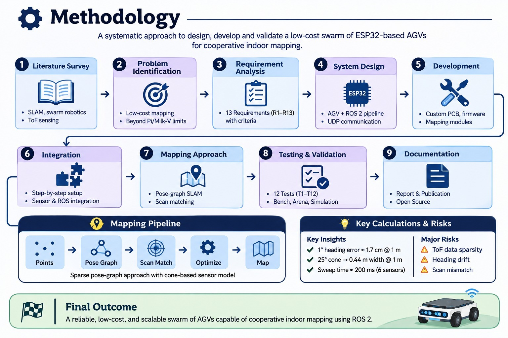

# BE CAPSTONE PROJECT 

## 🤖 Decentralized Swarm Autonomous Ground Vehicles
<p align="left">
  <a href="https://youtu.be/RQamKgik0cE?si=gTgPMuQe8ZkZP1P7">
    
  </a>
</p>


---
## 👥 Team Details

| **Sr. No.** | **Name of Student** | **Roll No.** | **Branch** | **Email ID** |
|:---:|:---|:---:|:---|:---|
| 1 | Abbas Najam | 59 |Automation and Robotics | [2023.abbas.najam@ves.ac.in](mailto:2023.abbas.najam@ves.ac.in) |
| 2 | Mayuresh Joshi | 49 | Automation and Robotics | [2023.mayuresh.joshi@ves.ac.in](mailto:2023.mayuresh.joshi@ves.ac.in) |
| 3 | Shravan Umrale | 66 | Automation and Robotics | [2023.shravan.umrale@ves.ac.in](mailto:2023.shravan.umrale@ves.ac.in) |
| 4 | Yash Vaychal | 31 | Automation and Robotics | [2023.yash.vaychal@ves.ac.in](mailto:2023.yash.vaychal@ves.ac.in) |

---

## Guide Details

**Project Guide:**  Deepti Khimani

**Department:** Automation and Robotics  

**Institute:** VESIT, Mumbai

# 📌 Project Overview

Swarm robotics is inspired by the collective behavior observed in nature, such as ants, bees and birds. Many simple units working together can cover more ground, and tolerate the loss of individual units better, than a single capable unit.

This project focuses on the design and development of a **six-robot low-cost differential-drive robotic swarm for cooperative indoor exploration and mapping**.

Each robot is designed around an ESP32-WROOM-32E microcontroller mounted on a custom-designed PCB. The PCB integrates the motor driver and DC-DC buck converter, reducing the need for separate electronic modules and simplifying the overall hardware assembly.

Each robot is equipped with:
- Six VL53L0X Time-of-Flight (ToF) distance sensors.
- One MPU6050 six-axis IMU.
- Two N20 geared DC motors with integrated wheel encoders.
- Two 34 mm rubber drive wheels.
- One ball caster.
- One 7.4 V, 2600 mAh LiPo battery.

The mechanical structure consists of a 3 mm laser-cut MDF base plate, custom 3D-printed PLA motor holders, a caster holder and spacers. M3 nuts and bolts are used for mechanical assembly.

The current implementation assumes that the robots begin from predefined and known starting positions and orientations. Estimating unknown starting poses and automatically aligning independently initialized robot maps are considered future extensions.


### Key Capabilities
Key Capabilities
* 🤖 Low-cost differential-drive robots (ESP32 on custom PCB)
* 📏 6-beam ToF sensing per robot
* 🧭 Odometry from wheel encoders fused with IMU gyro
* 🗺️ Per-robot SLAM using pose graph and scan matching
* 🧩 Merging of all robots' observations into one map
* 📡 Wi-Fi telemetry to a laptop and robot-to-robot pose sharing
* 🚧 Reactive obstacle avoidance and wall following
* 🧠 Decentralized exploration behaviour
* 📊 Live map viewer and replayable data logs
* 📐 Evaluation against tape-measured ground truth
---

# 🎯 Problem Statement


Teams of mobile robots map unknown indoor spaces faster than a single robot, and can keep working if one unit fails. But published multi-robot mapping systems depend on dense 2D LiDAR and a single-board Linux computer on every robot, which puts them out of reach of teaching laboratories and of applications where robots are expendable.

This project therefore designs, builds and evaluates a team of low-cost differential-drive robots, each with only an ESP32, six single-zone ToF sensors, an IMU and wheel encoders, that explore a known-size indoor arena from **known starting poses**, while a laptop combines their data into one two-dimensional map. The problem includes determining, **by measurement and not by assumption**, how accurate such a map is and which sensing, odometry and algorithmic factors limit that accuracy.

---

# 🚀 Objectives

The major objectives of this project are:

* Develop a decentralized multi-robot swarm system.
* Enable communication between multiple autonomous ground vehicles.
* Implement autonomous navigation.
* Implement mapping and localization.
* Develop obstacle avoidance capabilities.
* Implement distributed decision-making.
* Introduce swarm intelligence algorithms.
* Detect communication, sensor, and motor-related faults.
* Develop fault recovery mechanisms.
* Reallocate tasks when a robot becomes unavailable.
* Maintain swarm operation after individual robot failure.
* Validate the system through simulation.
* Develop and test physical AGV prototypes.
* Evaluate swarm performance under different fault conditions.

---
## Existing System

Describe the currently available system or method.

Mention its limitations:

- High cost
- Low accuracy
- Manual process
- Lack of automation
- Poor scalability
- Limited accessibility

---

## Proposed System

### 1. System Overview

The proposed system consists of multiple low-cost ESP32-based mobile robots that independently handle real-time operations such as sensor acquisition, wheel odometry, PID-based motion control, and data transmission. Computationally intensive tasks, including mapping, scan matching, and pose graph optimization, are performed centrally on a laptop.

The system uses a lightweight, open binary communication protocol to exchange sensor and odometry data over Wi-Fi. All transmitted data can also be stored in replayable logs, allowing offline algorithm development, testing, and evaluation.

### 2. System Working Principle

The system operates through the following sequence:

1. **Safe Robot Initialization:** At power-up, all motor driver input pins are configured LOW to prevent unintended motor movement. The ESP32 then connects to the Wi-Fi network and initializes the onboard sensors.

2. **Multi-Sensor Selection:** A custom-milled hub PCB uses a 74HC138 decoder and a 74HC04 inverter to select one of the six VL53L0X time-of-flight distance sensors at a time. Since all six sensors share the same default I2C address, the selection circuit enables individual sensor communication. The main PCB provides only two shutdown control lines.

3. **Odometry and Motion Control:** The robot combines MPU6050 gyroscope measurements with wheel encoder feedback to estimate its movement. Gyroscope bias is calibrated during startup. PID controllers are implemented for wheel speed regulation, angular turning, and linear distance control.

4. **Wireless Data Transmission:** Every 50 ms, each robot transmits a 36-byte binary data frame containing its estimated pose and distance measurements. Each frame includes the robot's own pose at the time of sensor acquisition, eliminating the need for clock synchronization between robots.

5. **Sensor Coverage:** By rotating through a partial angle (ϕ), the robot achieves a theoretical sensor coverage of:

   \[
   \text{Coverage} = 120^\circ + \phi
   \]

   Therefore, a complete 360° coverage requires a 240° rotation.

6. **Centralized Mapping and Optimization:** The laptop receives the transmitted frames and converts sensor measurements into world-coordinate points using a conical sensor model. It then performs scan matching, pose graph optimization, and map merging for robots with known initial positions. The resulting map and robot trajectories are visualized using RViz2.

### 3. Expected Outcomes and Benefits

The proposed system aims to provide the following benefits:

- **Low-Cost Hardware:** A cost-effective and replicable multi-robot platform built around ESP32 microcontrollers.
- **Modular Architecture:** Independent robot-level sensing, communication, odometry, and motion-control operations.
- **Closed-Loop Motion Control:** Calibrated PID-based control for accurate wheel speed, turning, and distance movement.
- **Sparse-Sensor Mapping:** An approach to mapping using six VL53L0X distance sensors, with clearly documented sensing limitations.
- **Offline Development:** Replayable sensor and odometry logs for testing and improving mapping algorithms without requiring physical robot operation.
- **System Validation:** A requirement-to-test structure that tracks implementation and verification status, ensuring that untested requirements remain clearly identified.

### 4. Centralized vs. Decentralized Architecture

The proposed system uses a **centralized mapping architecture with independent robot-level control**.

- **Robot-Level Operations:** Each robot independently handles its motor control, sensor acquisition, odometry estimation, and wireless data transmission. Robots do not require communication with neighbouring robots to perform these operations.
- **Centralized Operations:** Mapping, scan matching, pose graph optimization, and map merging are performed on a central laptop.
- **Optimization Architecture:** The closest published system also performs optimization on a single elected robot. Therefore, the proposed system does not claim to implement fully decentralized SLAM.

This distinction is important because independent robot operation does not necessarily imply decentralized mapping or SLAM.

---

## System Architecture


The proposed system follows a distributed architecture consisting of two main subsystems: an **ESP32-based Automated Guided Vehicle (AGV)** and a **Laptop-based ROS 2 processing system**. Both subsystems communicate wirelessly through Wi-Fi using UDP protocol for real-time data transmission and control.

### 1. AGV – Sensing and Control

The AGV is equipped with six VL53L0X Time-of-Flight (ToF) distance sensors, an MPU6050 IMU, and wheel encoders for environmental sensing and motion estimation.

The ESP32, mounted on a custom PCB, processes sensor data, performs odometry calculations and PID-based motor control, and generates heading-stamped sensor frames. A DRV8833 motor driver controls two N20 motors configured in a differential-drive arrangement.

### 2. Wireless Communication

The AGV communicates with the laptop over Wi-Fi using UDP.

- **Data Transmission:** The ESP32 sends 36-byte sensor data frames at 20 Hz to the laptop.
- **Command Transmission:** The laptop sends 10-byte control commands (Drive/Stop) back to the ESP32.

### 3. Laptop – ROS 2 Processing

The laptop runs Ubuntu with ROS 2 Humble.

- A UDP receiver collects incoming sensor data and logs it into CSV files.
- The ROS 2 bridge processes and publishes odometry, sensor ranges, TF transforms, point clouds, and velocity commands.
- The processed information is passed to the mapping pipeline for further computation.

### 4. Mapping and Visualization

The mapping pipeline consists of a scan builder, cone sensor model, and mapper.

- **Scan Builder:** Converts incoming sensor measurements into scan data.
- **Cone Sensor Model:** Models the sensor's field of view and measurements.
- **Mapper:** Uses scan matching and pose graph techniques to build and optimize the environment map.
- **Map Merger:** Combines mapping results for visualization.
- **RViz2:** Displays the generated map and relevant robot data.

### 5. Overall System Workflow

The complete architecture follows the workflow:

**Sensing → Processing → Wireless Communication → Mapping → Visualization**

This modular architecture integrates embedded systems, real-time motor control, wireless communication, and ROS 2-based mapping to develop an AGV capable of sensing its surroundings and building an environment map.

### Key Features

- Real-time environmental sensing using ToF sensors.
- ESP32-based onboard processing and PID motor control.
- Wireless communication using UDP over Wi-Fi.
- ROS 2-based sensor data processing.
- Scan matching and pose graph-based mapping.
- Real-time map visualization using RViz2.

---


## Hardware Requirements

| Sr. No. | Component | Specification / Model | Quantity |
|:---:|---|---|:---:|
| 1 | Microcontroller | ESP32-WROOM-32E | 6 |
| 2 | Custom PCB | ESP32, motor driver and buck converter integration | 6 |
| 3 | Motor Driver | Integrated on custom PCB | 6 |
| 4 | DC-DC Buck Converter | Integrated on custom PCB | 6 |
| 5 | IMU | MPU6050 (6-axis) | 6 |
| 6 | ToF Sensors | VL53L0X, 6 sensors per robot | 36 |
| 7 | N20 Motors | Geared DC motors with integrated encoders | 12 |
| 8 | Wheel Encoders | Integrated with N20 motors | 12 |
| 9 | Battery | LiPo 7.4 V, 2600 mAh (2S) | 6 |


##  Mechanical Components

| Sr. No. | Component | Specification | Quantity |
|:---:|---|---|:---:|
| 1 | Base Plate | 3 mm MDF, laser cut | 6 |
| 2 | Drive Wheels | 34 mm Mini Car N20 Motor Wheel, rubber | 12 |
| 3 | Caster Wheel | Mini 3Pi Car N20 Caster Robot Ball Wheel | 6 |
| 4 | Motor Holders | PLA 3D printed | 6 sets |
| 5 | Caster Holders | PLA 3D printed | 6 sets |
| 6 | Spacers | PLA 3D printed | 6 sets |
| 7 | Fasteners | M3 nut-and-bolt assembly | As required |


##  Mechanical and Sensor Component Specifications

| Sr. No. | Component | Model / Specification | Quantity | Product Link |
|:---:|---|---|:---:|---|
| 1 | N20 DC Gear Motor | 3V, 150 RPM, with integrated encoder | 12 | [Robu.in](https://robu.in/product/n20-3v-150rpm-micro-metal-gear-motor-with-encoder/) |
| 2 | ToF Distance Sensor | VL53L0X, I2C interface | 36 | [Robu.in](https://robu.in/product/vl53l0x-tof-based-lidar-laser-distance-sensor/) |
| 3 | Drive Wheel | 34 mm Mini Car N20 Motor Wheel, Rubber | 12 | [Robu.in](https://robu.in/product/34mm-mini-car-n20-motor-wheel-rubber-small-wheel/) |
| 4 | Caster Wheel | Mini 3Pi Car N20 Caster Robot Ball Wheel | 6 | [Robu.in](https://robu.in/product/mini-3pi-car-n20-caster-robot-ball-wheel/) |
---

## Software Requirements

The following software and development tools are required to run and develop the project.

| Software / Tool | Purpose |
|---|---|
| Ubuntu | Operating system for ROS 2 processing |
| ROS 2 Humble | Robot communication and data processing |
| Python 3 | UDP receiver, data logging and mapping modules |
| Arduino IDE | ESP32 firmware development and uploading |
| RViz2 | Real-time sensor data and point cloud visualization |
| NumPy | Numerical computations and data processing |
| Matplotlib | Data visualization and plotting |
| teleop_twist_keyboard | Keyboard-based AGV movement control |

### Required Libraries

**ESP32 Firmware Libraries**
- `Adafruit_VL53L0X` – Interface with VL53L0X ToF sensors.
- `Wire` – I2C communication with sensors and peripherals.
- `WiFi` – Wireless network connectivity.
- `WiFiUdp` – UDP-based wireless data transmission.

**Python Libraries**
- `numpy`
- `matplotlib`

### Additional Requirements
- ESP32 Dev Module board support package.
- 2.4 GHz Wi-Fi network for communication between AGV and laptop.
- USB connection for ESP32 programming and serial monitoring (115200 baud).
---

## Technologies Used

The project combines embedded systems, wireless communication, robotics middleware and mapping algorithms.

| Technology | Application |
|---|---|
| ESP32 | Main microcontroller for AGV control and sensing |
| Arduino Framework | Embedded firmware development |
| ROS 2 Humble | Robot middleware and communication |
| Python 3 | Data reception, logging and mapping pipeline |
| UDP Protocol | Real-time wireless sensor data transmission |
| Wi-Fi (2.4 GHz) | Communication between AGV and laptop |
| I2C Protocol | Communication with ToF sensors and IMU |
| PID Control | Closed-loop motor speed, distance and angle control |
| Odometry | Estimation of robot position and orientation |
| SLAM | Simultaneous localization and mapping |
| Scan Matching | Alignment of sensor scans |
| Pose Graph Optimization | Optimization of robot poses |
| RViz2 | Visualization of sensor data and mapping results |

### Mapping and Processing Techniques
- Cone-based sensor modelling.
- Partial-angle scan generation.
- Scan-to-map matching.
- Pose graph-based optimization.
- Multi-robot map merging with known starting poses.

---

## Methodology



The project follows a systematic development and implementation methodology to design and develop a low-cost swarm of ESP32-based differential-drive Automated Guided Vehicles (AGVs) for cooperative 2D indoor mapping. The methodology consists of the following stages:

### 1. Literature Survey

A detailed literature survey was conducted to understand existing approaches and identify suitable techniques for low-cost robotic mapping.

- Study of 2D LiDAR-based SLAM techniques.
- Review of scan matching algorithms such as ICP and Correlative Scan Matching.
- Study of collaborative SLAM and swarm robotics.
- Review of pose graph optimization techniques.
- Exploration of low-cost and sparse range-sensing approaches using Time-of-Flight (ToF) sensors.
- Study of existing frameworks such as Hector SLAM, Cartographer, slam_toolbox and tinySLAM.

### 2. Problem Identification

Existing multi-robot SLAM systems generally require expensive LiDAR sensors and powerful onboard computing platforms.

- The initial Raspberry Pi 4-based architecture was found to be expensive.
- The Milk-V Duo S architecture with RPLIDAR A1 faced computational limitations, with Python feature SLAM exceeding the 100 ms per-scan processing budget.
- Therefore, a low-cost ESP32-based architecture was selected to reduce hardware cost while retaining essential sensing, motion control and wireless communication capabilities.

### 3. Requirement Analysis

Thirteen functional requirements (R1–R13) were defined with measurable acceptance criteria before testing.

The requirements cover:

- Hardware development and sensor integration.
- Wireless communication and data transmission.
- Safe motor operation and command-loss handling.
- Robot geometry calibration and odometry.
- ToF sensor accuracy and scan generation.
- PID-based motion control.
- ROS 2 integration and live visualization.
- Scan matching and pose graph optimization.
- Multi-robot map merging.
- Data logging and system cost.

Each requirement was linked to its corresponding design element and validation test.

### 4. System Design

The final architecture was divided into two major subsystems:

**AGV Subsystem:**
- ESP32-WROOM-32E microcontroller on a custom PCB.
- Six VL53L0X ToF sensors arranged in a 120° front-facing arc.
- MPU6050 IMU and wheel encoders.
- Hub PCB using a 74HC138 decoder and 74HC04 inverter for sequential sensor selection.
- DRV8833 motor drivers and two N20 geared motors in a differential-drive configuration.

**Laptop Subsystem:**
- Ubuntu operating system with ROS 2 Humble.
- Python-based UDP receiver and CSV logger.
- ROS 2 communication bridge.
- Scan builder and cone-based sensor model.
- Scan matching and pose graph optimization.
- Map merging and RViz2 visualization.

A binary UDP communication protocol was designed for wireless data exchange between the AGVs and laptop.

### 5. Hardware and Software Development

The hardware and software components were developed and implemented separately before integration.

**Hardware Development:**
- Design and fabrication of the custom ESP32 PCB.
- Development of the sensor hub PCB.
- 3D printing of the ToF sensor mounting arc and mechanical holders.
- Assembly of the chassis, motors, wheels and power supply.
- Integration of the IMU, encoders and six ToF sensors.

**Software Development:**
- ESP32 firmware for sensor acquisition, odometry and PID motor control.
- Python-based UDP receiver and CSV data logger.
- ROS 2 bridge for publishing odometry, sensor ranges, transforms and point clouds.
- Python-based scan builder, sensor model, scan matcher and pose graph modules.
- Development of a tinySLAM-style onboard scan-to-map matcher for synthetic testing.

### 6. System Integration

The system was integrated incrementally to identify and resolve hardware and software issues at each stage.

The integration sequence followed:

1. ESP32 firmware flashing and serial monitoring.
2. Standalone UDP receiver testing.
3. ROS 2 bridge integration.
4. Sensor data visualization in RViz2.
5. Keyboard-based AGV movement control.
6. Hub PCB integration and sequential sensor initialization.
7. Integration of all six ToF sensors and the MPU6050.
8. Odometry calibration and PID controller tuning.
9. Complete wireless communication and system testing.

Each subsystem was checked before proceeding to the next integration stage.

### 7. Mapping Methodology

The mapping approach is based on a sparse pose-graph SLAM method adapted from the literature, particularly the approach described by Friess et al. The algorithm was independently reimplemented; the authors' GPL-3.0 source code was neither inspected nor copied.

**Step 1 – Point Generation**
- Convert each ToF measurement into a spatial point using the robot pose, sensor mounting angle and measured distance.
- Use the heading estimate recorded at the time of measurement.
- Combine the readings collected during a spin into a scan.

**Step 2 – Pose Graph Construction**
- Create one pose node for each robot waypoint.
- Connect consecutive nodes using odometry constraints.
- Store relative motion information between successive poses.

**Step 3 – Scan Matching**
- Match scans between nearby robot poses to estimate relative transformations.
- Use Correlative Scan Matching to search for the best alignment over position (x, y) and orientation (θ).
- Apply ICP refinement to improve the estimated alignment.
- Add the resulting scan-matching constraints to the pose graph.

**Step 4 – Pose Graph Optimization**
- Apply Gauss–Newton optimization to minimize the error between measured and predicted relative poses.
- Refine the estimated robot trajectory using odometry and scan-matching constraints.

**Step 5 – Map Generation**
- Re-project sensor scans using the optimized robot poses.
- Combine the corrected points to generate the environment map.
- Convert the resulting map into an occupancy grid for visualization.

**Additional Improvements for Sparse ToF Sensing:**
- Range-dependent cone-based sensor uncertainty modelling.
- Treat invalid or no-return sensor readings as unknown.
- Apply a short temporal median filter to reduce measurement noise.
- Use Correlative Scan Matching before ICP refinement to improve alignment with sparse sensor data.

### 8. Testing and Validation

A structured validation plan consisting of twelve tests (T1–T12) was defined to evaluate the system against the thirteen requirements.

Testing was conducted in different environments depending on the requirement:

- **Bench Testing:** Sensor initialization, hardware operation, calibration and motor safety.
- **Arena Testing:** Robot movement, turning accuracy, sensor measurements and wireless communication.
- **Replay Testing:** Processing recorded sensor logs on the laptop.
- **Simulation Testing:** Evaluation of mapping algorithms using synthetic data.

The validation process included:

- Sensor range accuracy and measurement noise.
- UDP transmission rate and packet loss.
- Command-loss safety and motor stopping response.
- Wheel odometry and PID motion accuracy.
- Sensor scan generation and RViz2 visualization.
- Scan matching and mapping performance.
- Multi-robot map merging.


### 9. Documentation and Publication

- Document the hardware design, software implementation and system architecture.
- Maintain source code, configuration files and reproducible test logs.
- Record the results, limitations and future improvements.
- Prepare the final BE project report and research paper.
- Publish the project documentation and implementation details on GitHub.

---

### Key Design Calculations

The following calculations were considered during system design and sensor modelling:

**1. Heading Error**

The lateral displacement caused by heading error is approximately:

\[
\epsilon_\perp \approx d\Delta\psi
\]

A heading error of 1° produces approximately 1.7 cm of lateral displacement for a point 1 m away.

**2. Sensor Cone Uncertainty**

The approximate lateral uncertainty is:

\[
\sigma_\perp \approx d\tan(\beta)
\]

For a 25° sensor cone, the uncertainty is approximately 0.44 m at a distance of 1 m, contributing to thick walls and reduced map accuracy.

**3. Sensor Sweep Time**

Since the six ToF sensors are read sequentially:

\[
T_{sweep}=N(t_b+t_{sel})
\]

Where:
- \(N\) = Number of sensors (6).
- \(t_b\) = Sensor ranging time.
- \(t_{sel}\) = Sensor selection, wake-up and configuration time.

With a 33 ms timing budget and assuming zero selection overhead, the calculated lower bound is approximately 200 ms. The actual selection time has not yet been measured on the robot.

**4. Spin Scan Coverage**

The total angular coverage is:

\[
\Theta=120^\circ+\phi
\]

Where \(\phi\) is the robot's spin angle. Full 360° coverage requires a 240° spin, taking approximately 5.3 seconds at 45°/s.

---

### Risk Management

| Risk ID | Identified Risk | Mitigation Strategy |
|---|---|---|
| K1 | Project schedule constraints | Prioritize motion control, scanning and mapping; freeze features when required. |
| K2 | Sparse or noisy ToF measurements | Perform sensor characterization and consider multizone sensors. |
| K3 | Heading drift affecting scan accuracy | Calibrate gyro bias, use closed-loop turns and stop-and-scan operation. |
| K4 | Incorrect scan matching in symmetric environments | Use asymmetric obstacles, residual checks and known starting positions. |
| K5 | Difficulty explaining implementation and contributions | Maintain contribution records, disclose AI assistance and conduct code walkthroughs. |

---

### Overall Methodology Workflow

**Literature Survey → Problem Identification → Requirement Analysis → System Design → Hardware & Software Development → System Integration → Mapping & Optimization → Testing & Validation → Documentation & Publication**

**Expected Outcome:** A low-cost, modular and scalable ESP32-based AGV platform designed for cooperative 2D indoor mapping using sparse ToF sensing, wireless communication and ROS 2-based processing.
---

## Project Timeline

| Week | Task Planned | Status |
|:---:|---|:---:|
| Week 1 | Problem finalization (final architecture fixed after Phase 1 and Phase 2) | Completed |
| Week 2 | Literature survey | Completed |
| Week 3 | Requirement analysis (R1 to R13, T1 to T12) | Completed |
| Week 4 | System design (Main PCB, Hub PCB, arc, and communication protocol) | Completed |
| Week 5 | Prototype development (Robot assembly; 4 out of 6 robots operational) | In Progress |
| Week 6 | Testing and validation (T1 to T12) | completed |
| Week 7 | Project documentation | completed  |
| Week 8 | Research paper writing | completed |


---

## Weekly Progress Updates

Students must update this section every week.

| Week   | Date | Work Completed | Work Planned for Next Week | Issues / Challenges | GitHub Commit Link |
| ------ | ---- | -------------- | -------------------------- | ------------------- | ------------------ |
| Week 1 |      |                |                            |                     |                    |
| Week 2 |      |                |                            |                     |                    |
| Week 3 |      |                |                            |                     |                    |
| Week 4 |      |                |                            |                     |                    |
| Week 5 |      |                |                            |                     |                    |
| Week 6 |      |                |                            |                     |                    |
| Week 7 |      |                |                            |                     |                    |
| Week 8 |      |                |                            |                     |                    |

---

## Design Files

Upload and link all design files here.

| File Type       | File Name / Link | Description |
| --------------- | ---------------- | ----------- |
| CAD Model       |                  |             |
| Circuit Diagram |                  |             |
| PCB Design      |                  |             |
| Flowchart       |                  |             |
| Simulation File |                  |             |

---

## Circuit Diagram

Add circuit diagram image here.

```markdown

```

---

## Flowchart / Algorithm


### Algorithm

1. Start
2. Initialize the system
3. Read input from sensors/user
4. Process the data
5. Generate output/control action
6. Display/store/transmit result
7. Stop

---

## Implementation Details

Explain the actual implementation of the project.

### Hardware Implementation

Write details about connections, components, power supply, sensors, actuators, PCB, enclosure, etc.

### Software Implementation

Write details about code structure, libraries used, algorithms, communication protocols, database, app, cloud, etc.

---

## Code Structure

```text
BE-Capstone-Project/
│
├── README.md
├── docs/
│   ├── literature_survey.md
│   ├── project_report.pdf
│   └── presentation.pptx
│
├── hardware/
│   ├── circuit_diagram.png
│   ├── pcb_design/
│   └── cad_model/
│
├── software/
│   ├── src/
│   ├── include/
│   └── tests/
│
├── images/
│   ├── system_architecture.png
│   ├── prototype_photo.jpg
│   └── results.png
│
└── references/
    └── papers/
```

---

## How to Run the Project

### Step 1: Clone the Repository

```bash
git clone https://github.com/username/project-name.git
```

### Step 2: Install Dependencies

```bash
pip install -r requirements.txt
```

or mention specific software/library installation steps.

### Step 3: Upload / Run the Code

```bash
python main.py
```

or

```bash
arduino-cli upload -p COMx --fqbn board_name
```

### Step 4: Observe the Output

Mention the expected output of the project.

---

## Testing and Results

| Test No. | Test Description | Expected Result | Actual Result | Status      |
| -------- | ---------------- | --------------- | ------------- | ----------- |
| 1        |                  |                 |               | Pass / Fail |
| 2        |                  |                 |               | Pass / Fail |
| 3        |                  |                 |               | Pass / Fail |

---

## Result Images / Videos

Add images or videos of the working prototype.

```markdown

```

Video Link: https://youtu.be/-i1T_cCoHbY

```markdown
[Project Demo Video](https://drive.google.com/your-video-link)
```

---

## Applications

1. Education and Research
   - A cheap platform for students and labs to study multi-robot SLAM and swarm behaviour without expensive sensors.

2. Indoor Mapping of Unknown Spaces
   - Multiple low-cost robots can map rooms or corridors faster than one robot.

3. Search and Rescue (Prototype Level)
   - Many inexpensive, expendable robots can explore collapsed or hazardous indoor areas.

4. Industrial and Warehouse Inspection
   - Small robots can map aisles and detect layout changes, cheaply and in parallel.

5. Hazardous Environment Exploration
   - Low-cost units can be risked in places that are unsafe for people.

6. Platform for Larger Swarm Experiments
   - The design can scale to more robots because each unit is inexpensive.

---

## Advantages


1. **Low-Cost Hardware Architecture**

   Uses ESP32 microcontrollers and integrated custom PCBs instead of expensive onboard computing platforms.

2. **Six-Robot Experimental Platform**

   Allows investigation of multi-robot cooperation rather than limiting experimentation to a single robotic platform.

3. **Custom PCB Integration**

   Integrates the microcontroller, motor driver and buck converter on a common PCB, reducing separate modules and wiring.

4. **Modular Mechanical Design**

   Laser-cut MDF and 3D-printed PLA components make mechanical modifications and replacement easier.

5. **ROS 2 Integration**

   Provides a flexible software environment for developing robot communication, mapping and visualization.

6. **Scalable Experimental Architecture**

   Provides a foundation for studying the addition of further robots, subject to communication, processing and hardware limitations.

7. **Practical Engineering Experience**

   Involves PCB development, embedded programming, mechanical design, 3D printing, ROS 2 and multi-robot system integration.

---

## Limitations

1. Sparse and Short-Range Sensing
   - VL53L0X sensors are single-zone, with about a 25 degree cone and a practical indoor range of about 1.2 m, worse on dark, glossy or sunlit surfaces. Scans are sparse compared with lidar.

2. Centralized Mapping
   - Mapping and optimization run on the laptop, so the system is not fully decentralized and depends on the laptop and Wi-Fi link for the merged map.

3. Accuracy Gain Only Where Paths Overlap
   - Away from overlapping regions each robot drifts like a single robot. Wheel slip and heading drift dominate odometry error.

4. Known Starting Poses
   - The current scope assumes known starting poses. Merging with unknown starting poses is future work.

5. Environment Sensitivity
   - Symmetric rooms and long featureless corridors make scan matching less reliable.

6. Battery and Communication Limits
   - Limited battery life, and Wi-Fi channel sharing between the laptop link and robot-to-robot messages can cause packet loss.

---

## Future Scope 

1. Unknown Starting Poses
   - Align robots' maps without known starts using multi-resolution correlative matching of submaps, with strict acceptance gates (score, overlap, margin, repeated consistency) to prevent wrong merges, and a measured false-merge rate in symmetric arenas.

2. Inter-Robot Relative Observations
   - Use rendezvous or markers to add direct robot-to-robot constraints to the pose graph.

3. Sensor Upgrade
   - Move to multizone ToF sensors (for example VL53L5CX) for denser scans if the VL53L0X array proves too sparse. Cost, size and driver complexity must be checked first.

4. More Decentralized Mapping
   - Move parts of mapping onto the robots, and elect a robot to run optimization, as in the ETH swarm work.

5. Fault Detection and Task Reallocation
   - Carry over ideas from the earlier project: detect communication, sensor and motor faults, and reassign exploration to other robots.

6. Ground-Truth Evaluation
   - Overhead camera with printed markers on the robots for pose error over time, used for evaluation only.


---

## Research Paper / Publication

| Item                      | Details                                                   |
| ------------------------- | --------------------------------------------------------- |
| Paper Title               |                                                           |
| Conference / Journal Name |                                                           |
| Paper Status              | Not Started / Drafting / Submitted / Accepted / Published |
| Submission Date           |                                                           |
| Paper Link                |                                                           |

---

## References

Add references in IEEE format.

Example:

```text
[1] A. Author, B. Author, "Title of the Paper," Journal/Conference Name, vol. X, no. Y, pp. xx-yy, Year.
[2] Datasheet / Website / Book reference.
```

---

## Repository Update Guidelines

Each student team must update the GitHub repository regularly.

Minimum expected updates:

* Update README every week.
* Push code changes regularly.
* Upload circuit diagrams, CAD files, PCB files, reports and presentations.
* Add weekly progress in the progress table.
* Maintain proper folder structure.
* Do not upload unnecessary temporary files.
* Each major update should have a meaningful commit message.

Example commit messages:

```text
Added problem statement and objectives
Updated system architecture diagram
Added sensor interfacing code
Updated weekly progress for Week 3
Added testing results and prototype images
```

---

## Declaration

We declare that this project work is carried out by our team as part of the BE Capstone Project. The work will be regularly updated on GitHub and all references used will be properly cited.

---

## License

This project is for academic use only.

Optional:

```text
MIT License / Creative Commons / Institute Use Only
```

```
```
